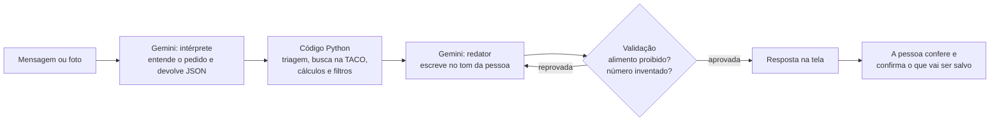

# NIT · Nutrição Intuitiva

Assistente de alimentação com IA generativa: cria receitas com o que você já tem em casa, monta um plano alimentar de acordo com seus objetivos e restrições, organiza a feira e acompanha o dia a dia.

> Projeto do Lab **"Construa seu Assistente Virtual com Inteligência Artificial"** da [DIO](https://www.dio.me/). O [repositório base do desafio](https://github.com/digitalinnovationone/dio-lab-bia-do-futuro) propõe um agente financeiro e permite adaptar a ideia para outro contexto. Aqui, o contexto é alimentação.

O projeto foi feito em 6 etapas, descritas abaixo em [Como o NIT foi construído](#como-o-nit-foi-construído).

> ⚠️ **O NIT não substitui um nutricionista.** Em casos de gestação, diabetes, doença renal, transtornos alimentares ou uso de medicação, ele não monta plano alimentar e orienta a procurar um profissional. Todos os usuários deste projeto são fictícios.

## O que o NIT faz

| # | Funcionalidade | Como funciona |
| --- | --- | --- |
| 1 | Receitas com o que tem em casa | Você informa os ingredientes, e o NIT sugere receitas que respeitam suas restrições |
| 2 | Plano alimentar | Um questionário levanta objetivo, restrições, rotina e nível de dedicação. Calorias e macronutrientes são calculados por fórmulas, não estimados pela IA |
| 3 | Lista de feira | Gerada a partir do plano, para 15 ou 30 dias, à sua escolha |
| 4 | Despensa | O que foi comprado entra, o que foi consumido sai |
| 5 | Checklist do dia | Refeições feitas e copos de água |
| 6 | Contador de calorias | Por descrição e peso ("150 g de arroz branco cozido"), com valores da TACO, ou pela foto da tabela nutricional da embalagem. Nos dois casos, você confere os dados antes de registrar |
| 7 | Previsão da próxima feira | Calculada pelo ritmo de consumo de cada item da despensa |
| 8 | Gastos reais | Você envia a foto do cupom fiscal, confere os itens lidos e o NIT calcula o custo médio da feira só com preços que você realmente pagou |
| 9 | Pontos e conquistas | Pontos por cumprir as tarefas do dia |
| 10 | Uso no celular | Interface que funciona no navegador do celular |

### Níveis de dedicação

| Nível | Para quem |
| --- | --- |
| Leve | Quer melhorar o que já come, sem mudar a rotina |
| Moderado | Segue um cardápio flexível |
| Intenso | Segue o plano com quantidades |
| Insano | "Eu sou uma máquina e não falho" |

### Princípios

- **Números vêm de dados, não da IA.** Valores nutricionais saem da Tabela Brasileira de Composição de Alimentos (TACO) ou da tabela nutricional da embalagem, e preços saem só dos cupons fiscais do próprio usuário. O NIT não inventa preço nem nutriente, e não estima calorias pela foto do prato, porque o peso da comida não dá para medir numa imagem.
- **Restrições são verificadas pelo código.** Um alimento proibido para a pessoa é retirado antes de qualquer sugestão chegar à IA.
- **Comida de verdade e acessível.** O NIT segue o Guia Alimentar para a População Brasileira, valoriza alimentos regionais e da época, a cultura alimentar indígena e afro-brasileira, e indica feiras e produtores da agricultura familiar e da reforma agrária como opção de compra mais barata e saudável.

## Etapas do desafio

| # | Etapa | Onde fica | Situação |
| --- | --- | --- | --- |
| 1 | Documentação do agente | [docs/01-documentacao-agente.md](docs/01-documentacao-agente.md) | ✅ Feita |
| 2 | Base de conhecimento | [data/](data/) e [docs/02-base-conhecimento.md](docs/02-base-conhecimento.md) | ✅ Feita |
| 3 | Prompts do agente | [docs/03-prompts.md](docs/03-prompts.md) | ✅ Feita |
| 4 | Aplicação funcional (Python + Streamlit + Gemini) | [src/](src/) e [tests/](tests/) | ✅ Feita |
| 5 | Avaliação e métricas | [docs/04-metricas.md](docs/04-metricas.md) e [scripts/avaliar.py](scripts/avaliar.py) | ✅ Feita |
| 6 | Pitch | [docs/05-pitch.md](docs/05-pitch.md) | ✅ Roteiro pronto (falta o vídeo) |

## Como o NIT foi construído

### O caminho de uma mensagem



A IA aparece duas vezes, e nenhuma delas faz conta. Em cada resposta do app, "Por trás da resposta" mostra a intenção identificada e o contexto exato que o Gemini recebeu.

### O processo, etapa por etapa

1. **Documentação do agente.** Antes de qualquer código, defini o problema, a persona (um amigo gentil que entende de nutrição), os quatro níveis de dedicação com o tom de cada um, a arquitetura e as limitações: o NIT não substitui um nutricionista e não monta plano em casos clínicos.
2. **Base de conhecimento.** A TACO só existe em PDF, então escrevi um [script](scripts/extrair_taco.py) que extrai os 597 alimentos e confere as calorias de cada um pela fórmula 4 × proteína + 4 × carboidrato + 9 × gordura. Depois vieram 25 receitas brasileiras e baratas, com cada ingrediente ligado a um alimento da TACO, as regras de 8 restrições e 7 pessoas fictícias, cada uma criada para testar um comportamento.
3. **Prompts.** Separei o Gemini em três papéis (intérprete, leitor de imagens e redator), cada um com seu prompt e sua configuração, e escrevi os casos difíceis antes de programar: gestação, jejum, tentativa de furar uma restrição e pedido de preço.
4. **Aplicação.** Primeiro, os módulos sem IA (cálculos, restrições, triagem, despensa, feira e pontos), que podem ser testados sozinhos. Depois, o fluxo com o Gemini, a validação das respostas e o app em Streamlit. Testar com o Gemini de verdade mostrou problemas que os testes sem IA não pegavam: o modelo padrão tinha sido retirado, os modelos novos ficavam sobrecarregados e a validação barrava respostas certas, como recusar o pão para quem é celíaca. Cada um virou uma correção e um teste.
5. **Métricas.** Uma bateria de 20 cenários roda pelo fluxo completo com o Gemini real. Resultado: intenção certa em 20 de 20, nenhum alimento proibido e nenhum número inventado em 20 de 20, e a resposta esperada em 19 de 20. A falha e os pontos a melhorar estão nos [resultados](docs/04-metricas.md).
6. **Pitch.** Roteiro de 3 minutos com demonstração no app ([roteiro](docs/05-pitch.md)).

### O que aprendi

- **Um prompt não garante uma regra.** A segurança está no código: antes da IA, que nem recebe o alimento proibido, e depois dela, que confere a resposta.
- **Testar com o modelo de verdade é indispensável.** Os testes com um modelo falso garantem as regras; só o modelo real mostra como ele escreve na prática.
- **Validação rígida demais também falha.** Barrar qualquer menção a "pão" impedia o NIT de explicar por que não podia sugerir pão. A regra certa é mais precisa: a pessoa pode citar o alimento, e o NIT só pode mencioná-lo numa recusa.

## Próximos passos (fora do escopo do protótipo)

Estas funcionalidades exigem login, banco de dados compartilhado e regras de privacidade para dados de saúde de pessoas reais, e por isso ficam para uma versão futura:

- **Comunidade:** convidar pessoas para grupos fechados ou abertos, com ranking coletivo de tarefas cumpridas.
- **Acompanhamento por nutricionista:** profissionais se cadastram com o registro no CRN validado e acompanham remotamente os pacientes que autorizarem o acesso aos próprios dados.
- **Privacidade:** consentimento explícito e controle de quem vê cada dado, como a LGPD exige para dados de saúde, que são dados pessoais sensíveis.

## Como rodar

Precisa do Python 3.12 e de uma chave gratuita do Gemini, criada no [Google AI Studio](https://aistudio.google.com/apikey).

```bash
python -m venv .venv
.venv\Scripts\activate            # no Linux ou macOS: source .venv/bin/activate
pip install -r requirements.txt
```

Crie um arquivo `.env` na raiz do projeto com a sua chave:

```text
GEMINI_API_KEY=sua-chave-aqui
```

Abra o aplicativo:

```bash
streamlit run src/app.py
```

Ele abre no navegador. Para usar no celular, abra o endereço "Network URL" que o Streamlit mostra, com o celular na mesma rede Wi-Fi.

Na barra lateral, escolha uma das 7 pessoas fictícias ou responda ao questionário como uma pessoa nova. Sem a chave do Gemini, a conversa e a leitura de fotos ficam desligadas, mas receitas, plano, feira, despensa, checklist, contador e pontos funcionam, porque não dependem de IA.

Os testes rodam sem internet e sem chave, com um modelo falso no lugar do Gemini:

```bash
python -m pytest tests
```

### Modelo do Gemini

O NIT tenta os modelos Flash do mais novo para o mais antigo (lista em [`src/nit/llm.py`](src/nit/llm.py)). Quando um está sobrecarregado, ele passa para o próximo. Para fixar um modelo, acrescente `GEMINI_MODEL=nome-do-modelo` ao `.env`.

## Estrutura

```text
NIT/
├── README.md          apresentação do projeto
├── requirements.txt   bibliotecas usadas
├── data/              base de conhecimento (alimentos, receitas, usuários fictícios)
├── docs/              documentação de cada etapa
├── scripts/           ferramentas de preparação dos dados (ex.: extração da TACO)
├── src/
│   ├── app.py         interface em Streamlit
│   └── nit/
│       ├── agente.py      fluxo de uma mensagem: intérprete, código, redator e validação
│       ├── llm.py         conexão com o Gemini (um método por papel)
│       ├── prompts.py     os três prompts de docs/03-prompts.md
│       ├── contexto.py    monta o contexto que o redator recebe, por intenção
│       ├── validacao.py   confere a resposta: alimento proibido e número inventado
│       ├── triagem.py     casos que vão para o nutricionista
│       ├── restricoes.py  o que cada pessoa não pode comer
│       ├── nutricao.py    TACO, gasto de energia e metas do dia
│       ├── plano.py       cardápio da semana e tamanho da porção
│       ├── busca.py       encontra o alimento da TACO pela descrição
│       ├── despensa.py    consumo, previsão da próxima feira e receitas com o que tem em casa
│       ├── feira.py       lista de feira
│       ├── gastos.py      gastos reais pelos cupons fiscais
│       ├── pontos.py      pontos e conquistas
│       ├── memoria.py     registros de cada pessoa em memoria/ (fora do Git)
│       └── dados.py       leitura dos arquivos de data/
└── tests/             testes automáticos (sem IA)
```
