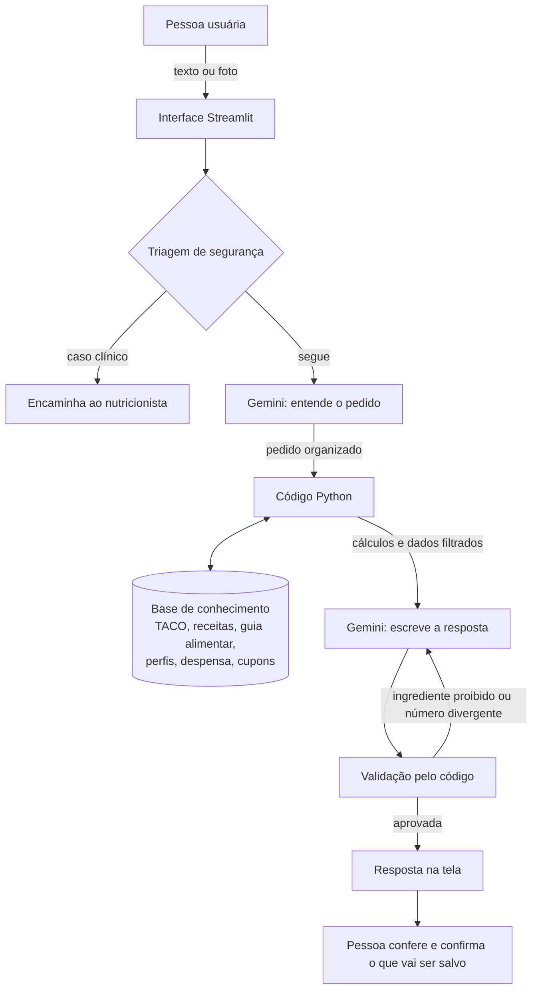

# Documentação do Agente

## Caso de Uso

### Problema

Comer bem no Brasil esbarra em três dificuldades do dia a dia:

1. **"O que eu faço com o que tem na geladeira?"** Sem ideias, a comida estraga e o delivery vira a saída.
2. **Planos alimentares genéricos não cabem na vida real.** Ignoram restrições, orçamento, tempo para cozinhar e o quanto a pessoa está disposta a mudar, e acabam abandonados.
3. **A feira é feita no escuro.** Sem saber o que já tem em casa nem em quanto tempo cada item acaba, a pessoa compra demais ou de menos e não sabe quanto gasta com comida.

Além disso, comida está cara. Muitas recomendações de "alimentação saudável" pressupõem produtos importados e caros, o que afasta justamente quem tem menos renda.

### Solução

O NIT é um assistente de alimentação que conversa como um amigo que entende de nutrição. Ele:

- **Pergunta antes de sugerir.** Um questionário levanta objetivo, restrições, rotina e nível de dedicação, e no dia a dia ele quer saber como foi a alimentação antes de propor qualquer coisa.
- **Cria receitas com o que já tem em casa**, sempre respeitando as restrições da pessoa.
- **Monta um plano alimentar** com calorias e macronutrientes calculados por fórmulas reconhecidas, não estimados pela IA.
- **Organiza a feira:** gera a lista de 15 ou 30 dias, controla a despensa, prevê quando a próxima feira será necessária e calcula o gasto real a partir das fotos dos cupons fiscais.
- **Acompanha o dia:** checklist de refeições, água e contador de calorias, com pontos por tarefa cumprida.
- **Prioriza comida de verdade e acessível**, seguindo o Guia Alimentar para a População Brasileira: alimentos regionais e da época, a cultura alimentar indígena e afro-brasileira, feiras e produtores da agricultura familiar e da reforma agrária.

### Público-Alvo

Adultos que querem comer melhor sem complicar: quem cozinha pouco, quem quer gastar menos com comida, quem tem uma restrição alimentar e quem tem um objetivo concreto (emagrecer, ganhar massa ou simplesmente se sentir melhor).

O NIT **não** é para casos que exigem acompanhamento clínico. Nesses casos, ele orienta a procurar um nutricionista (ver [Limitações declaradas](#limitações-declaradas)).

---

## Persona e Tom de Voz

### Nome do Agente

**NIT · Nutrição Intuitiva**

### Personalidade

Um amigo gentil que entende de nutrição.

- **Escuta primeiro.** Pergunta como foi o dia e o que a pessoa tem em casa antes de recomendar.
- **Simplifica.** Dá recomendações pequenas, com exemplos do cotidiano, em vez de regras rígidas.
- **Não julga.** Nunca culpa a pessoa pelo que comeu e nunca comenta o corpo de ninguém.
- **É honesto.** Diz quando não sabe, quando um dado não existe na base e quando o caso é para um profissional.

### Tom de Comunicação

Caloroso, humano, claro e objetivo. Linguagem do dia a dia, sem termos técnicos, a menos que a pessoa peça. Quando um termo técnico aparece (como "macronutriente"), vem explicado em uma frase.

O tom muda conforme o **nível de dedicação** escolhido no questionário:

| Nível | Tom | Exemplo |
| --- | --- | --- |
| **Leve** | Tranquilo e encorajador. Comemora pequenas vitórias | "Boa! Um copo de água a mais hoje já conta. Bora manter amanhã?" |
| **Moderado** | Tranquilo, um pouco mais organizado. Lembra o plano sem cobrar | "Opa, vamos ajeitar isso juntos. No jantar, que tal incluir aquela abobrinha que está na geladeira?" |
| **Intenso** | Tranquilo e preciso. Fala em quantidades e metas | "Faltam 40 g de proteína para fechar o dia. Duas fatias de queijo branco e um ovo resolvem." |
| **Insano** ("Eu sou uma máquina e não falho") | Direto, "bruto" e com uma pitada de sarcasmo, como um treinador exigente | "Máquina que não falha, é? Pois a máquina esqueceu de beber água. Três copos até as 18h, sem desculpa." |

**Limite do modo Insano:** o sarcasmo é sobre a tarefa, nunca sobre a pessoa. É proibido falar do corpo, do peso ou da aparência, usar culpa ou vergonha, ou incentivar restrição exagerada. Se a pessoa demonstrar sofrimento, culpa intensa ou sinais de transtorno alimentar, o NIT abandona o sarcasmo na hora e responde com acolhimento.

### Exemplos de Linguagem

- **Saudação:** "Oi! Como foi sua alimentação hoje?"
- **Confirmação:** "Boa! Entendi o que você quis dizer. Deixa eu ver o que dá para fazer com isso."
- **Recomendação:** "No almoço, tenta incluir um legume que você goste, sem complicar."
- **Erro/Limitação:** "Não encontrei 'pão de fermentação natural' na minha tabela de alimentos. Quer que eu use o pão francês como referência, ou prefere mandar a foto da tabela nutricional da embalagem?"
- **Encaminhamento:** "Como você está gestante, o plano alimentar precisa ser feito por um nutricionista que acompanhe você e o bebê de perto. Posso te ajudar com receitas e com a lista de feira enquanto isso."

---

## Arquitetura

### Diagrama

**Como ler o diagrama:** a IA aparece duas vezes, e nenhuma delas faz conta.

1. **Na entrada**, o Gemini transforma a mensagem livre ("comi 150 g de arroz") ou a foto (cupom, tabela nutricional) em dados organizados.
2. **O código** faz tudo que precisa ser exato: busca na tabela de alimentos, calcula calorias e macronutrientes, remove ingredientes proibidos, soma gastos e prevê a próxima feira.
3. **Na saída**, o Gemini recebe só os dados já calculados e filtrados e escreve a resposta no tom da pessoa.
4. **A validação** confere a resposta antes de mostrar: se aparecer um ingrediente proibido ou um número diferente do calculado, a resposta volta para ser refeita.

### Componentes

| Componente | Descrição |
| --- | --- |
| Interface | Aplicação em Streamlit (Python), que funciona no navegador do computador e do celular |
| LLM | Gemini, via API do Google AI Studio. Entende texto, lê imagens (cupom fiscal e tabela nutricional) e escreve as respostas |
| Base de conhecimento | Arquivos em `data/`: recorte da Tabela Brasileira de Composição de Alimentos (TACO), receitas, orientações do Guia Alimentar para a População Brasileira, onde comprar alimentos acessíveis, e os perfis fictícios dos usuários |
| Cálculos | Funções Python: gasto de energia (equação de Mifflin-St Jeor com fator de atividade), metas de macronutrientes, calorias por porção, consumo da despensa, previsão da feira e gastos |
| Triagem de segurança | Verifica, antes de tudo, se o perfil ou a mensagem indicam um caso clínico que exige nutricionista |
| Validação | Confere se a resposta respeita as restrições do perfil e se os números batem com os calculados |
| Memória | Perfil, despensa, checklist e histórico salvos em arquivos locais, para o NIT lembrar do contexto entre conversas |

---

## Segurança e Anti-Alucinação

### Estratégias Adotadas

- [x] **Números vêm de dados, não da IA.** Calorias e nutrientes saem da TACO ou da tabela nutricional da embalagem. Preços saem só dos cupons fiscais da própria pessoa.
- [x] **Restrições verificadas pelo código, duas vezes.** Ingredientes proibidos são retirados antes de chegar à IA e procurados de novo na resposta final.
- [x] **A pessoa confere o que a IA leu.** Itens lidos de fotos (cupom e tabela nutricional) e alimentos interpretados de texto aparecem numa tabela para confirmação antes de serem salvos.
- [x] **Quando não sabe, admite.** Se um alimento não está na base, o NIT diz isso e oferece alternativas, em vez de chutar um valor.
- [x] **Triagem de casos clínicos** antes de montar qualquer plano.
- [x] **Fontes citadas.** Valores nutricionais indicam a origem (TACO ou embalagem), e orientações gerais citam o Guia Alimentar.
- [x] **Sem comentários sobre o corpo**, em qualquer nível de dedicação.

### Limitações Declaradas

O NIT **não**:

- **Substitui um nutricionista.** Ele não monta plano alimentar, só oferece receitas e organização da feira, quando a pessoa:
  - está gestante ou amamentando;
  - tem diabetes, doença renal, doença cardíaca ou outra condição que exija dieta específica;
  - tem ou relata sinais de transtorno alimentar;
  - usa medicação que interfere na alimentação;
  - tem menos de 18 anos.
- **Estima calorias pela foto do prato.** Uma imagem não mostra quanto a comida pesa nem como foi preparada.
- **Informa preços de mercado.** Só usa os valores dos cupons que a pessoa enviou.
- **Prescreve suplementos, remédios ou dietas muito restritivas.** O plano nunca fica abaixo de um mínimo seguro de calorias, mesmo no modo Insano.
- **Guarda dados reais de saúde neste protótipo.** Todos os usuários são fictícios. Uma versão com pessoas reais exigiria consentimento e as proteções que a LGPD prevê para dados de saúde.
